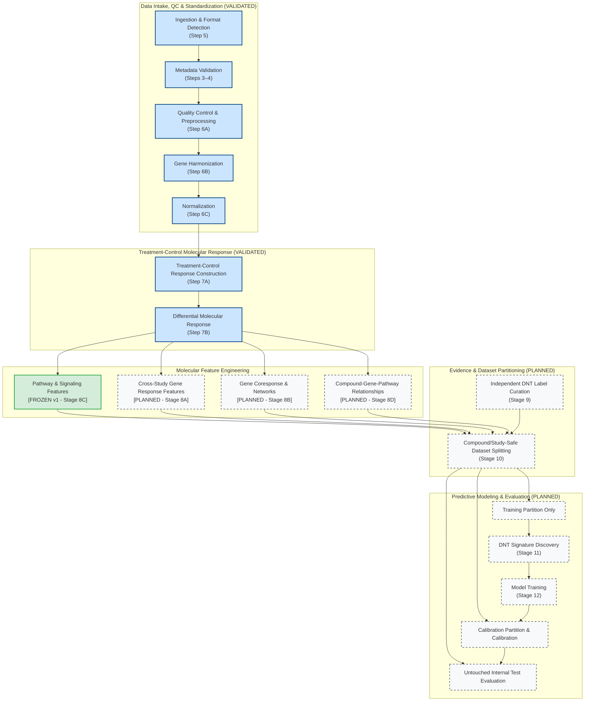

# Scientific Pipeline Architecture Map

This document defines the high-level architecture of the DNT Organoid AI platform.

---

## 1. High-Level Flowchart

---

## 2. Leakage-Safe Governance Rules

1. **Independent Evidence & Splitting Before Feature Selection**:
   * Molecular response features and independent DNT labels are joined only to perform **Compound/Study-Safe Dataset Splitting**.
   * The primary splitting requirement is **whole-compound and appropriate study-family grouping**, ensuring that observations from the same chemical entity or study family never cross into validation or test partitions.
   * Chemical-class holdout (e.g. holding out an entire chemical class) is treated as a separately prespecified generalization experiment rather than an unconditional mandatory default for all splits.
2. **Signature Discovery Uses Training Data Only**:
   * DNT Signature Discovery must occur **strictly after partitioning** and operate exclusively on the **Training Partition**.
   * Calibration compounds and test chemicals must never influence gene/pathway signature selection, filtering, or weight optimization.
3. **Untouched Test Evaluation**:
   * The final test partition remains completely untouched through signature discovery, model fitting, and probabilistic calibration, serving strictly for prospective generalization assessment.

---

## 3. Module Breakdown & Data Transition Contracts

### Data Intake, QC & Standardization (Implemented & Validated)
* **Goal**: Convert heterogeneous public and in-house RNA-seq files into canonically identified, technically qualified, normalized expression matrices.
* **Internal Layers**:
  1. *Ingestion & Format Detection* (Step 5): Identifies format (`FASTQ`, `raw_counts`, `UMI_counts`, `H5AD`) and assigns modality route (`BULK_RAW_COUNT_PIPELINE`, etc.).
  2. *Metadata Validation* (Steps 3–4): Validates study, experiment, assay, sample, and exposure records against the canonical schema.
  3. *Quality Control & Preprocessing* (Step 6A): Checks matrix integrity (integer counts, library size, zero fraction, replicate correlation).
  4. *Gene Harmonization* (Step 6B): Maps raw gene identifiers to canonical Ensembl Release 112 IDs while retaining unmapped genes.
  5. *Normalization* (Step 6C): Estimates official DESeq2 size factors using the median-of-ratios method within metadata-defined cohorts.
* **Transition Contract**: Produces a `NormalizedDataset` containing size factors and normalized diagnostic counts.

---

### Treatment-Control Molecular Response (Implemented & Validated)
* **Goal**: Construct rigorous treatment-versus-matched-control contrasts and compute genome-wide differential expression statistics.
* **Internal Layers**:
  1. *Treatment-Control Response Construction* (Step 7A; `src/response_builder`): Pairs treated organoid conditions with matched vehicle controls sharing the same study, experiment, developmental age, and organoid protocol ($\ge 2$ true biological replicates per arm).
  2. *Differential Molecular Response* (Step 7B; `src/differential_expression`): Executes negative binomial generalized linear model fitting (DESeq2 Wald test) across all 60,207 canonical genes with gene-universe conservation auditing.
* **Transition Contract**: Produces a `DifferentialExpressionContrastResult` containing log2 fold changes, standard errors, Wald statistics, p-values, and BH-adjusted FDR for all evaluated genes.

---

### Molecular Feature Engineering (Partially Implemented & Frozen)
* **Goal**: Extract biologically meaningful, standardized feature representations from the unbiased molecular response.
* **Components**:
  1. *Pathway & Signaling Features* (**FROZEN v1 - tag: [`stage8c-v1-frozen`](https://github.com/bioprintingLabsInc/DNT-Organoid-AI/tree/stage8c-v1-frozen)**; Stage 8C): Preranked GSEA using clusterProfiler for GO BP and KEGG based on finite Wald statistics, with strict preservation of the 32,140 statistically eligible gene universe.
  2. *Cross-Study Gene Response Features* (Planned; Stage 8A): Random-effects meta-analysis pooling biologically comparable within-study effects ($log_2\text{FC}$ and SE) across independent studies.
  3. *Gene Coresponse & Networks* (Planned; Stage 8B): Models co-regulated gene modules learned within training partitions only, alongside optional fixed reference interactomes.
  4. *Compound-Gene-Pathway Relationships* (Planned; Stage 8D): Organizes experimental compound-gene and compound-pathway relationships with explicit distinction from external annotation sources.

---

### Evidence & Dataset Partitioning (Planned)
* **Goal**: Curate ground-truth reference evidence and enforce leakage-safe train/test splits.
* **Components**:
  1. *Independent DNT Label Curation* (Planned; Stage 9): Curates high-confidence reference positive and negative toxicant evidence independently of gene expression data.
  2. *Compound/Study-Safe Dataset Splitting* (Planned; Stage 10): Partitions datasets by whole chemical compounds and study families into training, calibration, and test splits.

---

### Predictive Modeling & Evaluation (Planned)
* **Goal**: Discover sparse transcriptomic signatures, train predictive classifiers, and calibrate prospective risk scores.
* **Components**:
  1. *DNT Signature Discovery* (Planned; Stage 11): Identifies minimal, robust gene/pathway signatures strictly within the training partition.
  2. *Model Training & Calibration* (Planned; Stage 12): Fits classifiers on training data, calibrates probabilistic scores on calibration partitions, and validates on untouched test sets.
