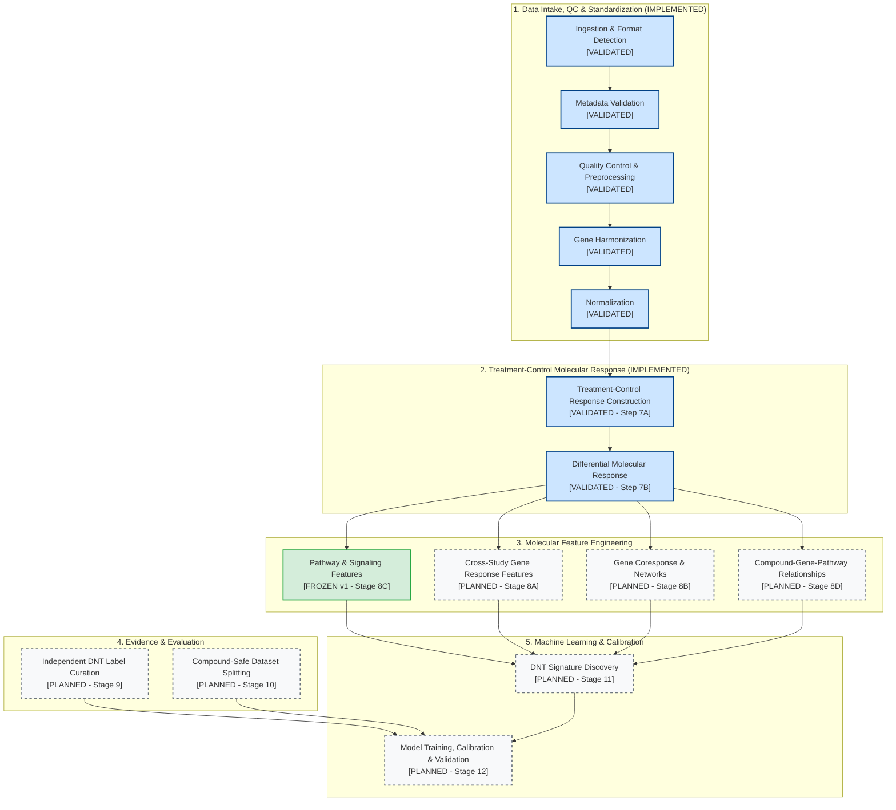

# Scientific Pipeline Architecture Map

This document defines the high-level architecture of the DNT Organoid AI platform.

---

## 1. High-Level Flowchart

---

## 2. Stage Breakdown & Data Transition Contracts

### Stage 1: Data Intake, QC & Standardization (Implemented & Validated)
* **Goal**: Convert heterogeneous public and in-house RNA-seq files into canonically identified, technically qualified, normalized expression matrices.
* **Internal Layers**:
  1. *Ingestion & Format Detection*: Identifies format (`FASTQ`, `raw_counts`, `UMI_counts`, `H5AD`) and assigns modality route (`BULK_RAW_COUNT_PIPELINE`, etc.).
  2. *Metadata Validation*: Validates study, experiment, assay, sample, and exposure records against the canonical schema.
  3. *Quality Control & Preprocessing*: Checks matrix integrity (integer counts, library size, zero fraction, replicate correlation).
  4. *Gene Harmonization*: Maps raw gene identifiers to canonical Ensembl Release 112 IDs while retaining unmapped genes.
  5. *Normalization*: Estimates official DESeq2 size factors using the median-of-ratios method within metadata-defined cohorts.
* **Transition Contract**: Produces a `NormalizedDataset` containing size factors and normalized diagnostic counts.

---

### Stage 2: Molecular Response Foundations (Implemented & Validated)
* **Goal**: Construct rigorous treatment-versus-matched-control contrasts and compute genome-wide differential expression statistics.
* **Internal Layers**:
  1. *Treatment-Control Response* (`src/response_builder`): Pairs treated organoid conditions with matched vehicle controls sharing the same study, experiment, developmental age, and organoid protocol ($\ge 2$ true biological replicates per arm).
  2. *Differential Molecular Response* (`src/differential_expression`): Executes negative binomial generalized linear model fitting (DESeq2 Wald test) across all 60,207 canonical genes with gene-universe conservation auditing.
* **Transition Contract**: Produces a `DifferentialExpressionContrastResult` containing log2 fold changes, standard errors, Wald statistics, p-values, and BH-adjusted FDR for all evaluated genes.

---

### Stage 3: Molecular Feature Engineering (Partially Implemented & Frozen)
* **Goal**: Extract biologically meaningful, standardized feature representations from the unbiased molecular response.
* **Components**:
  1. *Pathway & Signaling Features* (**FROZEN v1 - tag: `stage8c-v1-frozen`**): Preranked GSEA using clusterProfiler for GO BP and KEGG based on finite Wald statistics, with strict preservation of the 32,140 statistically eligible gene universe.
  2. *Cross-Study Gene Response Features* (*Planned*): Standardizes baseline gene-level sensitivity and effect sizes across distinct organoid lines and exposure regimens.
  3. *Gene Coresponse & Networks* (*Planned*): Models co-regulated gene modules and functional network topology.
  4. *Compound-Gene-Pathway Relationships* (*Planned*): Integrates known chemical targets and bioactivity data.

---

### Stage 4: Independent Labels & Splitting (Planned)
* **Goal**: Curate ground-truth reference evidence and enforce leakage-safe train/test splits.
* **Components**:
  1. *DNT Label Curation*: Curates high-confidence reference positive and negative toxicant evidence independently of gene expression data.
  2. *Compound-Safe Splitting*: Partitions datasets so that entire chemical classes and studies are held out from training sets.

---

### Stage 5: Machine Learning & Calibration (Planned)
* **Goal**: Train predictive models, discover sparse DNT signatures, and calibrate prospective risk scores.
* **Components**:
  1. *DNT Signature Discovery*: Identifies minimal, robust gene/pathway signatures indicative of organoid developmental impairment.
  2. *Model Training & Calibration*: Fits supervised classifiers, evaluates cross-study generalizability, and calibrates probabilistic confidence.
