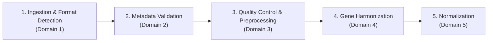

# Umbrella Module: Data Intake, QC & Standardization

## 1. Module Overview
* **Scientific Scope**: Standardizes heterogeneous public and in-house human brain-organoid RNA-seq datasets into technically qualified, canonically mapped, normalized count matrices.
* **Architectural Principle**: A single umbrella stage composed of **five distinct, sequential failure domains**. Each domain isolates a specific technical concern, ensuring clear diagnostics and preventing silent data corruption.

---

## 2. Five Separate Failure Domains

| Sub-Module / Failure Domain | Core Responsibility | Failure Symptom | Primary Inspection Target |
| :--- | :--- | :--- | :--- |
| **[1. Ingestion & Format Detection](ingestion_and_format_detection/README.md)** | Header inspection, magic-byte checks, modality routing | File unreadable, unsupported format | [`src/routing/detector.py`](../../../../src/routing/detector.py) |
| **[2. Metadata Validation](metadata_validation/README.md)** | Contract verification, foreign key integrity | Invalid metadata, missing attributes | [`src/metadata/validator.py`](../../../../src/metadata/validator.py) |
| **[3. Quality Control & Preprocessing](quality_control_and_preprocessing/README.md)** | Library size, zero fraction, replicate correlation | Sample failure, outlier sample | [`src/qc/validator.py`](../../../../src/qc/validator.py) |
| **[4. Gene Harmonization](gene_harmonization/README.md)** | Ensembl 112 mapping, collision detection | Unmapped genes, symbol collisions | [`src/gene_harmonization/harmonizer.py`](../../../../src/gene_harmonization/harmonizer.py) |
| **[5. Normalization](normalization/README.md)** | Cohort formation, DESeq2 size-factor estimation | Size factor failure, R bridge error | [`src/normalization/normalizer.py`](../../../../src/normalization/normalizer.py) |

---

## 3. End-to-End Inputs and Outputs

* **Upstream Input**: Raw RNA-seq files (CSV/TSV counts, FASTQ) + canonical metadata dictionary.
* **Downstream Output**: `NormalizedDataset` containing size factors, diagnostic normalized counts, and complete audit findings.
* **Downstream Consumer**: `pipeline/treatment_control_response/` (`src/response_builder/`).
